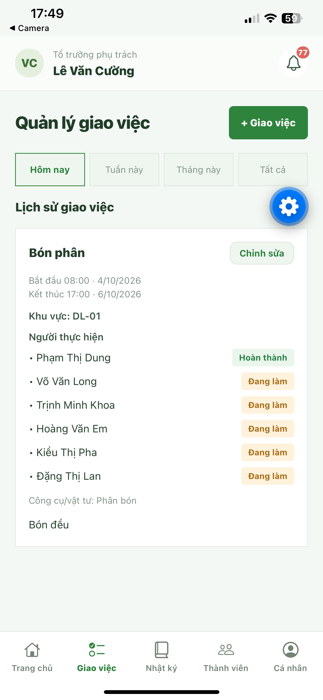
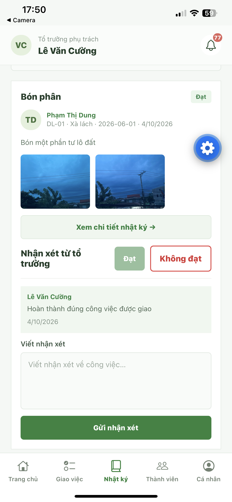
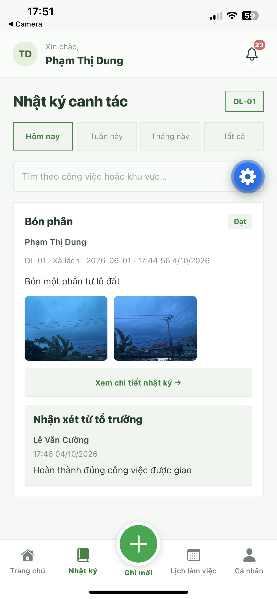
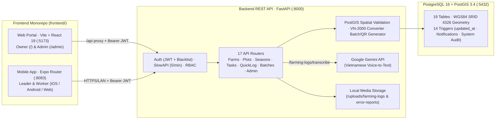

<div align="center">

# AgriTrace Platform (`AgriFarm`)

**Nền tảng Quản lý Sản xuất Nông nghiệp Số, Nhật ký Đồng ruộng (Farmer QuickLog) & Truy xuất Nguồn gốc Nông sản**

[](https://fastapi.tiangolo.com/)
[](https://postgis.net/)
[](https://react.dev/)
[](https://expo.dev/)
[](https://www.typescriptlang.org/)
[](https://www.docker.com/)

[Tính năng nổi bật](#1-điểm-nhấn-kỹ-thuật) · [Chức năng theo vai trò](#2-hệ-thống-làm-được-gì-tính-năng-theo-4-vai-trò) · [Kiến trúc](#3-kiến-trúc-hệ-thống) · [Công nghệ](#4-công-nghệ--cấu-trúc-mã-nguồn) · [Chạy thử nhanh](#5-hướng-dẫn-cài-đặt--chạy-thử-quick-start)

</div>

---

**AgriTrace Platform** là một hệ thống **Full-stack Monorepo** số hóa trọn vẹn vòng đời canh tác nông nghiệp: từ quy hoạch ranh giới nông trại & vùng trồng trên bản đồ GIS, điều phối nhân sự và công việc theo tổ đội, tự động hóa lịch nhắc chăm sóc cây trồng, ghi nhật ký đồng ruộng nhanh (**Farmer QuickLog**) tích hợp **GPS + Ảnh thực địa + AI Voice-to-Text tiếng Việt**, cho đến gom lô thu hoạch và phát hành **tem nhãn mã QR** truy xuất nguồn gốc.

Dự án vận hành trên **một Backend API thống nhất** kết hợp **hai ứng dụng Frontend chuyên biệt** phục vụ 4 nhóm người dùng (`Admin`, `Owner`, `Leader`, `Worker`):
- **Web Portal (`React 19 + Vite + Leaflet`)**: Phục vụ **Chủ nông trại (`Owner`)** quản trị đa nông trại/bản đồ/sản xuất và **Quản trị viên (`Admin`)** vận hành toàn hệ thống.
- **Mobile App (`React Native + Expo Router`)**: Phục vụ **Tổ trưởng (`Leader`)** và **Công nhân (`Worker`)** tác nghiệp trực tiếp ngoài đồng ruộng.

---

## 1. Điểm Nhấn Kỹ Thuật

| Hạng mục | Giải pháp triển khai thực tế trong mã nguồn |
| :--- | :--- |
| **Bản đồ GIS & Chuyển đổi tọa độ địa chính VN-2000** | Lưu trữ đa giác ranh giới chuẩn **WGS84 (`SRID 4326`)** trên **PostGIS**. Hỗ trợ nhập trực tiếp tọa độ phẳng **VN-2000** từ hồ sơ địa chính (múi 3° `k0=0.9999` và 6° `k0=0.9996`, hỗ trợ tên tỉnh/kinh tuyến trục độ-phút-giây) và quy đổi sang WGS84 bằng `pyproj` kèm bộ giải dự phòng 7 tham số Helmert (`QĐ 05/2007/QĐ-BTNMT`) tại [`vn2000.py`](./backend/app/utils/vn2000.py). |
| **Ràng buộc không gian đa tầng (Spatial Invariants)** | Backend kiểm tra bằng `ST_Contains` để đảm bảo mọi lô đất nằm trọn trong ranh giới nông trại cha và tự tính diện tích theo hecta (`ST_Area`). Frontend (`Leaflet`) kiểm tra chống chồng lấn giữa các nông trại, chống tự cắt cạnh đa giác, chống trùng vùng trồng, đồng thời khóa chỉnh sửa ranh giới khi lô đang có mùa vụ hoạt động. |
| **Farmer QuickLog & AI Voice-to-Text tiếng Việt** | Ứng dụng di động tự đọc GPS thiết bị, gọi `GET /plots/locate` (PostGIS `ST_Contains`) để tự nhận diện đúng **lô đất & mùa vụ đang canh tác**. Hỗ trợ ghi âm giọng nói tiếng Việt trực tiếp và gửi về `POST /farming-logs/transcribe` sử dụng **Google Gemini API** để phiên âm tự động thành nội dung nhật ký, kết hợp chụp & nén ảnh JPEG (`2–5` ảnh/nhật ký). |
| **Tự động hóa ở tầng Cơ sở dữ liệu (19 bảng, 14 Triggers)** | Khởi tạo mùa vụ tự động sinh `reminder_schedules` theo mốc sinh trưởng của giống cây (`crop_care_milestones`). Database Triggers tự động gửi `notifications` khi nhắc việc đến hạn (`sent`), khi có báo cáo lỗi mới/phản hồi từ Admin, và tự ghi Audit Trail vào `system_logs` khi khóa tài khoản, đổi vai trò hoặc chuyển trạng thái mùa vụ. |
| **Bảo mật, Chống Brute-force & Cô lập dữ liệu (RBAC)** | Mật khẩu băm **Bcrypt**, **JWT** có `jti` kết hợp bảng `token_blacklist` để thu hồi token ngay khi đăng xuất hoặc đổi mật khẩu; giới hạn tốc độ **SlowAPI (`5/minute`)** cho đăng nhập & khôi phục mật khẩu OTP; kiểm soát quyền sở hữu nông trại (`ensure_owns_org`) và snapshot `team_id` trên nhật ký để không làm sai lệch quyền xem khi luân chuyển nhân sự. |

---

## 2. Hệ Thống Làm Được Gì? (Tính Năng Theo 4 Vai Trò)

### Chủ Nông Trại (`Owner` — Web Portal `/`)
- **Tổng quan đa nông trại**: Chuyển đổi linh hoạt giữa từng nông trại hoặc xem tổng hợp toàn bộ nông trại sở hữu (vùng trồng đang dùng, mùa vụ đang theo dõi, công việc hôm nay, sản lượng thu hoạch trong ngày).
- **Quản lý Nông trại & Vùng trồng (GIS)**: Tạo hồ sơ nông trại và phân chia các lô đất (`plots`) bằng 3 cách: chấm/kéo thả điểm trực tiếp trên bản đồ **Leaflet/OpenStreetMap**, nhập file tọa độ (`JSON`, `CSV`, `TXT`, `KML`), hoặc nhập tọa độ địa chính **VN-2000**.
- **Quản lý Mùa vụ & Lịch nhắc nhở**: Khởi tạo mùa vụ trên các lô trống (tự tính ngày thu hoạch dự kiến từ `growth_days` và tự sinh lịch nhắc chăm sóc), gán nhiều tổ công nhân hỗ trợ mùa vụ, quản lý/phát hành nhắc việc đến hạn (`POST /reminders/dispatch`), theo dõi trạng thái (`Đang canh tác` → `Sẵn sàng thu hoạch` → `Đã hoàn thành`).
- **Nhân sự, Tổ đội & Giao việc**: Tạo tài khoản nhân sự, phân tổ, bổ nhiệm/thay đổi Tổ trưởng (đảm bảo 1 người chỉ làm Tổ trưởng 1 tổ tại một thời điểm), khóa/mở khóa tài khoản; giao việc và thu hồi việc chưa hoàn thành.
- **Giám sát Nhật ký & Đánh giá**: Lọc nhật ký theo mùa vụ/hoạt động/thời gian/trạng thái ghi chú, xem ảnh thực địa + vị trí điểm GPS trên bản đồ ranh giới lô đất, đánh giá `Đạt` / `Không đạt` hoặc để lại ghi chú nhắc nhở.
- **Lô thu hoạch & Tem nhãn QR**: Gom sản lượng từ các mùa vụ cùng giống cây đủ điều kiện thu hoạch (`ready_to_harvest` / `completed`), tự động sinh mã lô chuẩn hóa (`AGT-<4 ký tự farm>-<YYYYMMDD>-<4 hex>`), kích hoạt sinh mã QR (`qrcode.react`) và tải ảnh PNG tem nhãn về in.
- **Hỗ trợ & Báo lỗi**: Gửi báo cáo sự cố kèm ảnh chụp màn hình lên Admin và theo dõi phản hồi xử lý.

### Tổ Trưởng (`Leader` — Mobile App)
- **Dashboard tổ sản xuất**: Theo dõi nhanh số thành viên đang hoạt động, số nhật ký của tổ trong ngày, việc cần làm / đã hoàn thành hôm nay và danh sách việc được Owner giao riêng cho Tổ trưởng.
- **Điều phối & Chỉnh sửa Giao việc**: Chọn loại công việc từ danh mục hoặc nhập tùy chỉnh, chọn hàng loạt thành viên trong tổ, chọn mùa vụ/lô đất, ngày bắt đầu–kết thúc, công cụ/vật tư và ghi chú hướng dẫn; theo dõi tiến độ từng người nhận và chỉnh sửa/hủy phân công.
- **Duyệt Nhật ký Canh tác**: Xem nhật ký kèm ảnh và tọa độ GPS của công nhân trong tổ, đánh giá **Đạt / Không đạt**, để lại bình luận nhắc nhở và đánh dấu xử lý (`log_notes`).
- **Tác nghiệp & Quản lý Tổ**: Xem danh sách vùng trồng được gán cho tổ, xem hồ sơ chi tiết từng thành viên & thống kê công việc hoàn thành, trực tiếp ghi nhận nhật ký QuickLog.

### Công Nhân (`Worker` — Mobile App)
- **Màn hình Việc hôm nay & Lịch tuần**: Xem danh sách nhiệm vụ được giao trong ngày, cảnh báo **Công việc cần làm lại** khi bị Tổ trưởng đánh giá `Không đạt`, chuyển trạng thái **Bắt đầu** → **Hoàn thành** gắn liền với nhật ký thực địa.
- **Farmer QuickLog ngoài đồng ruộng**:
  1. Tự động lấy tọa độ GPS thiết bị và đối soát PostGIS xác định đúng **lô đất & mùa vụ** (chặn gửi nếu đứng ngoài vùng canh tác hoặc sai lô được giao).
  2. Nhập mô tả bằng bàn phím hoặc **bấm micro nói tiếng Việt** để AI chuyển giọng nói thành văn bản.
  3. Chụp `2–5` ảnh hiện trạng (tự động chuẩn hóa & nén JPEG trên máy để tiết kiệm 3G/4G), hỗ trợ lưu nháp tránh mất dữ liệu khi đang thao tác.
- **Nhật ký, Thông báo & Hỗ trợ**: Tra cứu lịch sử nhật ký đã ghi và nhận xét từ Tổ trưởng/Chủ nông trại, nhận thông báo công việc/ghi chú mới, gửi báo lỗi kèm ảnh và đổi mật khẩu.

### Quản Trị Viên Hệ Thống (`Admin` — Web Portal `/admin`)
- **Quản lý Tài khoản Toàn hệ thống**: Cấp mới tài khoản Chủ nông trại (`Owner`), xem/chỉnh sửa hồ sơ người dùng, hỗ trợ đổi vai trò (`leader`/`worker`) và khóa/mở khóa tài khoản khẩn cấp.
- **Quản trị Danh mục Giống cây chuẩn**: CRUD giống cây (`crop_catalog`) và các mốc chăm sóc chuẩn theo số ngày sau gieo (`crop_care_milestones`) làm dữ liệu nền cho toàn hệ thống sinh lịch nhắc tự động.
- **Tiếp nhận & Xử lý Báo cáo sự cố**: Phân loại báo cáo lỗi từ mọi nông trại kèm ảnh minh họa, cập nhật tiến độ (`new` → `processing` → `resolved` / `rejected`) và gửi phản hồi (DB Trigger tự động thông báo lại cho người gửi).
- **Giám sát Nhật ký Hệ thống (`Audit Trail`)**: Tra cứu toàn bộ lịch sử thao tác quản trị & sự kiện kiểm toán tự động từ Database Triggers.

### Hình Ảnh Giao Diện Mobile Thực Tế

<table>
  <tr>
    <td align="center" width="33%">
      <br/>
      <sub><b>Leader · Quản lý giao việc</b><br/>Theo dõi tiến độ theo từng công nhân</sub>
    </td>
    <td align="center" width="33%">
      <br/>
      <sub><b>Leader · Duyệt nhật ký</b><br/>Đánh giá Đạt / Không đạt &amp; phản hồi</sub>
    </td>
    <td align="center" width="33%">
      <br/>
      <sub><b>Worker · Nhật ký canh tác</b><br/>Ảnh thực địa &amp; nhận xét từ Tổ trưởng</sub>
    </td>
  </tr>
</table>

---

## 3. Kiến Trúc Hệ Thống



**Tổ chức Backend 3 tầng nghiêm ngặt (`backend/app/`)**:
- `routers/` (17 modules, 102 route endpoints gồm `/health`): Tiếp nhận HTTP request, xác thực JWT, kiểm tra phân quyền vai trò (`require_role`) và quyền sở hữu nông trại (`ensure_owns_org`).
- `crud/`: Lớp truy cập dữ liệu thuần túy sử dụng **SQLAlchemy `text()` với Parameterized Queries**, xử lý truy vấn không gian PostGIS (`ST_Contains`, `ST_Area`, `ST_MakePoint`, `ST_AsGeoJSON`).
- `schemas/`: **Pydantic v2** DTO kiểm soát chặt chẽ dữ liệu vào/ra.

---

## 4. Công Nghệ & Cấu Trúc Mã Nguồn

### Tech Stack

| Tầng | Công nghệ sử dụng |
| :--- | :--- |
| **Backend API** | Python 3.11, FastAPI 0.115.0, Uvicorn 0.30.6, Pydantic v2 (2.9.2), SlowAPI 0.1.9 |
| **Database & GIS** | PostgreSQL 16, PostGIS 3.4 (WGS84 `SRID 4326`), SQLAlchemy 2.0.35, GeoAlchemy2 0.15.2, `pyproj >= 3.6.1` |
| **Bảo mật & AI** | `python-jose` (JWT + `jti` Blacklist), Passlib + Bcrypt 4.0.1, Google Gemini API (`generateContent` cho Voice-to-Text) |
| **Web Portal** | React 19.3, TypeScript 6.0, Vite 8.3, React Router DOM 7.18, Leaflet 1.9.4, `qrcode.react`, `lucide-react` |
| **Mobile App** | React Native 0.88.1, Expo SDK 58, Expo Router 58, `expo-location`, `expo-audio`, `expo-image-picker`, `expo-image-manipulator`, AsyncStorage |
| **Hạ tầng** | Docker & Docker Compose v2 (`postgis/postgis:16-3.4` + `python:3.11-slim`) |

### Cấu trúc thư mục thực tế

```text
AgriTrace_Platform_Group_2/
├── docker-compose.yml                  # Định nghĩa 2 services: agritrace_db (5432) & agritrace_backend (8000)
├── database/
│   ├── init_db.sql                     # Schema 19 bảng, PostGIS extension, 14 Triggers (updated_at, notify, audit)
│   ├── sample_data.sql                 # Dữ liệu mẫu đầy đủ cho toàn bộ 19 bảng & 4 vai trò
│   └── erd_farmer_quicklog_full.html   # Sơ đồ ERD trực quan
├── backend/
│   ├── Dockerfile
│   ├── requirements.txt
│   ├── .env.example
│   └── app/
│       ├── main.py                     # Khởi tạo FastAPI, CORS, StaticFiles (/uploads), SlowAPI, 17 routers + /health
│       ├── core/                       # config.py, limiter.py, security.py (JWT, Bcrypt, get_current_user)
│       ├── db/                         # session.py (Engine, SessionLocal, get_db)
│       ├── routers/                    # auth, password_recovery, user, organization, plot, team, crop, season,
│       │                               # tasks, havest_batches, batch_seasons, farming_log, log_note,
│       │                               # notifications, reminder_schedules, error_reports, system_logs
│       ├── crud/                       # Parameterized SQL & PostGIS queries cho từng module
│       ├── schemas/                    # Pydantic v2 Input/Output schemas
│       └── utils/                      # vn2000.py (VN-2000 -> WGS84), batch_code.py, qr_generator.py
├── frontend/
│   ├── package.json                    # Quản lý scripts cho cả Web Portal (:5173) và Mobile App (:8083)
│   ├── vite.config.mts                 # Vite config (proxy /api và /uploads tới backend :8000)
│   ├── start_dev.cjs                   # Khởi chạy song song Web Portal & Expo Mobile
│   ├── app.json                        # Cấu hình Expo (Location, Camera, Microphone, Audio permissions)
│   ├── START_OWNER.cmd                 # Script khởi chạy nhanh Web Portal trên Windows
│   ├── test/                           # Bộ unit & contract tests (node --test)
│   └── src/
│       ├── (website)/                  # Web Portal (Owner tại / và Admin tại /admin)
│       ├── (mobile)/                   # Mobile App (Worker tại /worker và Leader tại /leader)
│       ├── components/                 # Leaflet Maps, VN-2000 Import, Dictation, QR Code, UI theo vai trò
│       ├── contexts/                   # Auth, Farm, WorkSchedule, Report, Notification, Leader Contexts
│       ├── hooks/                      # GPS + Locate hook, Polling, Discard warning...
│       ├── sevices/                    # API Clients & typed service adapters cho Web & Mobile
│       └── utils/                      # Tính toán hình học đa giác (geometry_wb.ts), parser ranh giới...
└── docs/                               # Đặc tả nghiệp vụ, API docs, hướng dẫn & ảnh giao diện
```

---

## 5. Hướng Dẫn Cài Đặt & Chạy Thử (Quick Start)

### Yêu cầu môi trường
- **Docker** & **Docker Compose v2**
- **Node.js** (khuyên dùng v20+) & **npm**
- Ứng dụng **Expo Go** trên iOS/Android (nếu chạy Mobile trực tiếp trên điện thoại thật)

### Bước 1: Cấu hình biến môi trường Backend
```bash
cp backend/.env.example backend/.env
```
Mở `backend/.env` (tạo từ [`backend/.env.example`](./backend/.env.example)) và điền các biến cần thiết:
```env
DATABASE_URL=postgresql://agritrace:agritrace_pass@db:5432/agritrace_farm
SECRET_KEY=thay-bang-chuoi-bi-mat-ngau-nhien-cua-ban
ALGORITHM=HS256
ACCESS_TOKEN_EXPIRE_MINUTES=240

# Tùy chọn: Bật luồng quên mật khẩu OTP giả lập trên môi trường thử nghiệm
PASSWORD_RESET_DEMO_ENABLED=true

# Tùy chọn: API Key Google AI Studio (Gemini) cho tính năng Voice-to-Text khi ghi nhật ký
GEMINI_API_KEY=
GEMINI_TRANSCRIBE_MODEL=gemini-3.5-flash-lite
```

### Bước 2: Khởi động Database PostGIS, Backend & Nạp dữ liệu mẫu
```bash
# 1. Khởi chạy PostgreSQL/PostGIS (5432) và FastAPI Backend (8000)
docker compose up -d --build

# 2. Nạp dữ liệu thử nghiệm mẫu (chạy 1 lần sau khi container DB khởi động xong)
# Trên macOS / Linux:
docker exec -i agritrace_db psql -U agritrace -d agritrace_farm < database/sample_data.sql

# Trên Windows PowerShell:
# Get-Content -Raw database/sample_data.sql | docker exec -i agritrace_db psql -U agritrace -d agritrace_farm

# 3. Kiểm tra kết nối Backend <-> Database
curl -s http://localhost:8000/health
```
- **Swagger UI (Interactive API Docs)**: [`http://localhost:8000/docs`](http://localhost:8000/docs)
- **ReDoc**: [`http://localhost:8000/redoc`](http://localhost:8000/redoc)

### Bước 3: Khởi chạy Frontend (Web Portal & Mobile App)
```bash
cd frontend
npm ci
cp .env.example .env
```
> **Lưu ý nếu test Mobile trên điện thoại thật (Expo Go):** Mở `frontend/.env` (tạo từ [`frontend/.env.example`](./frontend/.env.example)) và sửa `EXPO_PUBLIC_API_BASE_URL` thành địa chỉ IP LAN của máy đang chạy Backend (ví dụ: `http://192.168.1.53:8000`). Với Web Portal, giữ mặc định `VITE_API_BASE_URL=/api` và `VITE_API_PROXY_TARGET=http://localhost:8000`.

Chọn một trong các lệnh khởi chạy sau từ thư mục `frontend/`:

```bash
# Cách 1: Chạy đồng thời CẢ Web Portal (:5173) và Mobile Expo Server (:8083)
npm run dev

# Cách 2: Chỉ chạy Web Portal cho Owner & Admin (http://localhost:5173)
npm run web

# Cách 3: Chỉ chạy Mobile App với Expo Go (:8083) hoặc mở giao diện Mobile trên trình duyệt
npm run mobile
# hoặc: npm run mobile:web
```
*(Trên Windows, có thể chạy nhanh Web Portal bằng cách mở tệp [`frontend/START_OWNER.cmd`](./frontend/START_OWNER.cmd).)*

### Tài Khoản Dùng Thử Mẫu (`sample_data.sql`)

Mật khẩu dùng chung cho tất cả tài khoản thử nghiệm: **`Test@1234`**

| Vai trò | Số điện thoại | Họ tên | Phạm vi dữ liệu mẫu | Nền tảng đăng nhập |
| :--- | :--- | :--- | :--- | :--- |
| **Owner** | `0901000001` | Nguyễn Văn An | Nông trại Thực nghiệm NEU & Nông trại Hữu cơ Đơn Dương | **Web Portal (`http://localhost:5173`)** |
| **Admin** | `0900000008` | Trần Thị Bình | Toàn hệ thống (tự động chuyển hướng `/admin`) | **Web Portal (`http://localhost:5173`)** |
| **Leader** | `0901000002` | Lê Văn Cường | Tổ 1 - Rau ăn lá (Nông trại Thực nghiệm NEU) | **Mobile App (`:8083` / Expo Go)** |
| **Worker** | `0901000003` | Phạm Thị Dung | Tổ 1 - Rau ăn lá (Nông trại Thực nghiệm NEU) | **Mobile App (`:8083` / Expo Go)** |
| **Owner 2** | `0902000001` | Vũ Thị Phương | Hợp tác xã Rau sạch Mộc Châu | **Web Portal (`http://localhost:5173`)** |

---

## 6. Kiểm Thử, Chất Lượng Mã Nguồn & Phạm Vi Hiện Tại

Từ thư mục `frontend/`, dự án cung cấp các lệnh kiểm tra chất lượng và build production:

```bash
npm run web:build         # TypeScript check (tsconfig.web.json) + Vite build cho cả Owner & Admin
npm run mobile:typecheck  # TypeScript check cho Mobile App
npm run lint              # ESLint cho cả Mobile và Web
node --test test/*.test.cjs  # Chạy bộ unit tests cho notification, routing, task, VN-2000 & service adapters
```
*(Lưu ý: test đối chiếu OpenAPI trong `web_api_services.test.cjs` cần môi trường Python đã cài đặt dependencies của `backend/`.)*

**Một số lưu ý kỹ thuật về trạng thái hiện tại**:
- **Truy xuất nguồn gốc QR**: Tính năng sinh mã lô, tạo URL truy xuất và xuất/tải ảnh mã QR cho lô thu hoạch đã hoàn thiện trên Owner Web (`HarvestDetailPage_wb.tsx`); route trang tra cứu công khai `/trace/:batchCode` (`TraceabilityPage_wb.tsx`) hiện đang để màn hình thông báo chưa mở truy cập công khai.
- **Khôi phục mật khẩu OTP**: Luồng 3 bước `/auth/forgot-password` → `/verify-otp` → `/reset-password` sử dụng cơ chế OTP demo (tắt mặc định khi `PASSWORD_RESET_DEMO_ENABLED=false`, chưa tích hợp cổng gửi SMS thương mại).

---

## 7. Tài Liệu Tham Khảo Trong Kho Mã Nguồn

- [`docs/Quy_Trinh_Nghiep_Vu.md`](./docs/Quy_Trinh_Nghiep_Vu.md) — Đặc tả quy trình nghiệp vụ, State Machines, Business Rules & Use Cases.
- [`docs/API_Documentation.md`](./docs/API_Documentation.md) — Tài liệu tham khảo các nhóm REST API *(khuyến nghị đối chiếu trực tiếp tại Swagger `/docs` khi backend đang chạy để có schema mới nhất)*.
- [`database/README.md`](./database/README.md) & [`database/erd_farmer_quicklog_full.html`](./database/erd_farmer_quicklog_full.html) — Mô tả chi tiết ERD 19 bảng & sơ đồ tương tác.
- [`QUY TẮC LÀM VIỆC VỚI GIT-GITHUB CỦA NHÓM.md`](./QUY%20T%E1%BA%AEC%20L%C3%80M%20VI%E1%BB%86C%20V%E1%BB%9AI%20GIT-GITHUB%20C%E1%BB%A6A%20NH%C3%93M.md) — Quy ước nhánh, commit & Pull Request của nhóm phát triển.
