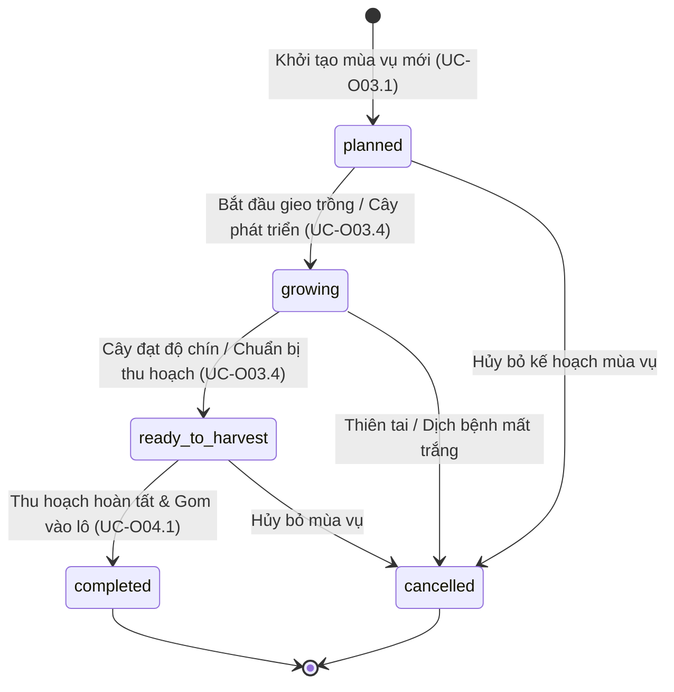
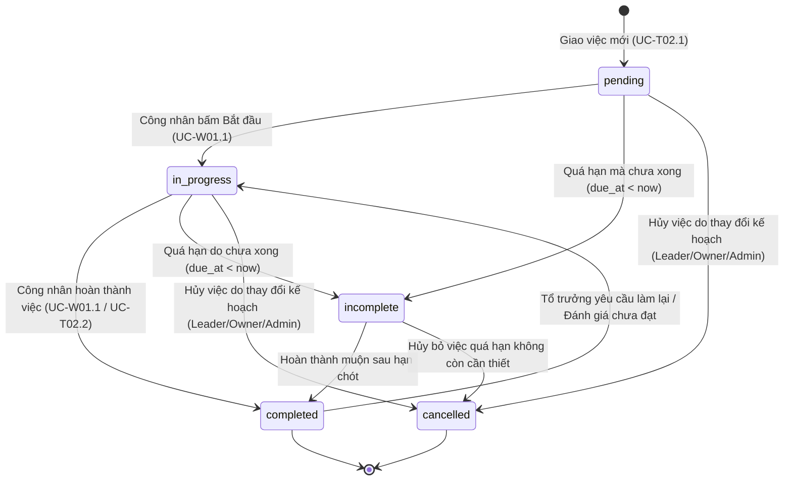
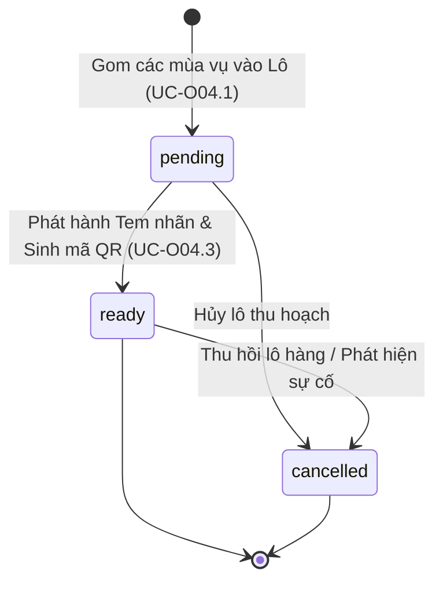
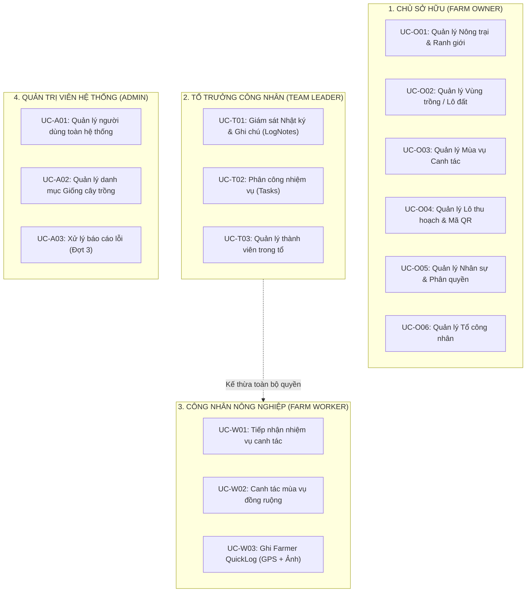

# TÀI LIỆU ĐẶC TẢ QUY TRÌNH VÀ QUY TẮC NGHIỆP VỤ HỆ THỐNG
# HỆ THỐNG QUẢN LÝ NÔNG TRẠI KỸ THUẬT SỐ & FARMER QUICKLOG (AGRITRACE PLATFORM)

---

## MỤC LỤC
1. [Chương 1: Tổng quan hệ thống, Bối cảnh và Kế hoạch phân bổ các đợt phát triển](#chương-1-tổng-quan-hệ-thống-bối-cảnh-và-kế-hoạch-phân-bổ-các-đợt-phát-triển)
2. [Chương 2: Danh mục Actors, Nguyên tắc kế thừa và Ma trận phân quyền](#chương-2-danh-mục-actors-nguyên-tắc-kế-thừa-và-ma-trận-phân-quyền)
3. [Chương 3: Vòng đời nghiệp vụ và Sơ đồ trạng thái (State Machines)](#chương-3-vòng-đời-nghiệp-vụ-và-sơ-đồ-trạng-thái-state-machines)
4. [Chương 4: Hệ thống Quy tắc nghiệp vụ cốt lõi (Business Rules: BR-01 – BR-20)](#chương-4-hệ-thống-quy-tắc-nghiệp-vụ-cốt-lõi-business-rules-br-01--br-20)
5. [Chương 5: Danh mục Use Cases chi tiết theo từng Actor](#chương-5-danh-mục-use-cases-chi-tiết-theo-từng-actor)
   - [5.1. Nhóm Chủ sở hữu nông trại (Farm Owner - Prefix: UC-O)](#51-nhóm-chủ-sở-hữu-nông-trại-farm-owner---prefix-uc-o)
   - [5.2. Nhóm Tổ trưởng công nhân (Team Leader - Prefix: UC-T)](#52-nhóm-tổ-trưởng-công-nhân-team-leader---prefix-uc-t)
   - [5.3. Nhóm Công nhân nông nghiệp (Farm Worker - Prefix: UC-W)](#53-nhóm-công-nhân-nông-nghiệp-farm-worker---prefix-uc-w)
   - [5.4. Nhóm Quản trị viên hệ thống (System Admin - Prefix: UC-A)](#54-nhóm-quản-trị-viên-hệ-thống-system-admin---prefix-uc-a)
   - [5.5. Nhóm Use Cases dùng chung (Shared - Prefix: UC-SH)](#55-nhóm-use-cases-dùng-chung-shared---prefix-uc-sh)
6. [Chương 6: Danh mục và Kịch bản xử lý ngoại lệ (Exceptions: EX-01 – EX-20)](#chương-6-danh-mục-và-kịch-bản-xử-lý-ngoại-lệ-exceptions-ex-01--ex-20)
7. [Chương 7: Mô hình Dữ liệu và Thiết kế Cơ sở Dữ liệu (ERD 19 bảng & Ràng buộc PostGIS)](#chương-7-mô-hình-dữ-liệu-và-thiết-kế-cơ-sở-dữ-liệu-erd-19-bảng--ràng-buộc-postgis)

---

## CHƯƠNG 1: TỔNG QUAN HỆ THỐNG, BỐI CẢNH VÀ KẾ HOẠCH PHÂN BỔ CÁC ĐỢT PHÁT TRIỂN

### 1.1. Bối cảnh và Mục tiêu dự án
Hệ thống **AgriTrace Platform - Phân hệ Sản Xuất Số & Farmer QuickLog** được thiết kế nhằm số hóa toàn diện quy trình sản xuất và quản trị tại các hợp tác xã, trang trại nông nghiệp hiện đại:
* **Quản trị địa không gian vùng trồng:** Định danh và quản lý ranh giới nông trại (`organizations`) cùng các lô đất nhỏ (`plots`) dựa trên tọa độ bản đồ không gian thực tế (PostGIS Polygon GeoJSON WGS84 SRID 4326), tính toán diện tích tự động và ngăn chặn sự chồng lấn/vượt ranh giới.
* **Tổ chức nhân sự nhiều cấp bậc:** Mô hình phân quyền phân cấp 4 vai trò rõ ràng: Chủ sở hữu (`owner`) $\rightarrow$ Tổ trưởng (`leader`) $\rightarrow$ Công nhân nông nghiệp (`worker`) dưới sự giám sát kỹ thuật của Quản trị viên (`admin`).
* **Theo dõi mùa vụ & tự động hóa lịch nhắc nhở:** Khởi tạo mùa vụ canh tác (`seasons`), ràng buộc độc quyền lô đất, tự động sinh lịch nhắc việc (`reminder_schedules`) dựa trên các mốc sinh trưởng chuẩn từ danh mục giống cây trồng (`crop_care_milestones`).
* **Công cụ Farmer QuickLog:** Giúp công nhân và tổ trưởng ghi chép nhật ký canh tác nhanh ngay tại hiện trường ruộng đồng qua thiết bị di động, tự động gắn tọa độ GPS hiện trường và upload ảnh chụp hiện trạng cây trồng.
* **Giám sát & Phản hồi kỹ thuật:** Tổ trưởng và Chủ sở hữu theo dõi tiến độ, ghi chú phản hồi/nhắc nhở kỹ thuật dưới nhật ký (`log_notes`) và bật cờ `resolved` khi sự cố canh tác đã được giải quyết.
* **Lô thu hoạch & Truy xuất nguồn gốc:** Gom các mùa vụ đạt độ chín vào Lô thu hoạch (`harvest_batches`), tự động sinh mã định danh chuẩn hóa `batch_code` và tạo **Mã QR tem nhãn** phục vụ người tiêu dùng quét tra cứu nguồn gốc nông sản.

---

### 1.2. Kế hoạch phân bổ các đợt phát triển Backend (Roadmap & Implementation Status)

> [!IMPORTANT]
> **Hiện trạng triển khai Backend của dự án:**
> - **Đợt 0, Đợt 1 và Đợt 2: ĐÃ HOÀN THÀNH 100% Ở PHÍA BACKEND API.**
> - **Đợt 3: CHƯA TRIỂN KHAI Ở BACKEND** (Gồm các module bổ trợ: `reminder_schedules`, `error_reports`, `notifications`, `system_logs`). Các chức năng này sẽ được phát triển và tích hợp trong giai đoạn sau.

Bảng tổng hợp lộ trình phân bổ theo kế hoạch kỹ thuật:

| Đợt | Trọng tâm phân hệ | Bảng CSDL phụ trách | Mục tiêu nghiệp vụ | Trạng thái Backend |
| :---: | :--- | :--- | :--- | :---: |
| **Đợt 0** | **Nền tảng Auth & Bảo mật** | `users`, `token_blacklist` | Đăng nhập SĐT, cấp JWT Access Token, đăng xuất đưa token vào blacklist, Rate Limiter `5/minute` chống brute-force, đổi mật khẩu. | <span style="color:green;font-weight:bold;">ĐÃ XONG</span> |
| **Đợt 1** | **Quản lý Nông trại, Vùng trồng, Tổ & Mùa vụ** | `organizations`, `plots`, `teams`, `crop_catalog`, `crop_care_milestones`, `seasons`, `season_team_assignments` | CRUD Nông trại & ranh giới GeoJSON; CRUD Lô đất & kiểm tra PostGIS `ST_Contains`; CRUD Tổ công nhân & chỉ định tổ trưởng; Danh mục giống cây trồng & mốc chăm sóc; Khởi tạo mùa vụ độc quyền trên lô đất & gán tổ hỗ trợ. | <span style="color:green;font-weight:bold;">ĐÃ XONG</span> |
| **Đợt 2** | **Farmer QuickLog, Phân công việc & Lô thu hoạch** | `farming_logs`, `log_photos`, `log_notes`, `tasks`, `harvest_batches`, `batch_seasons` | Nhật ký canh tác đồng ruộng gắn GPS; Upload tối đa 5 ảnh JPG $\le$ 5MB; Tổ trưởng ghi chú `log_notes` (cờ `resolved`); Phân công và quản lý tiến độ `tasks`; Gom mùa vụ vào Lô thu hoạch, tự sinh `batch_code` và phát hành Mã QR tem nhãn. | <span style="color:green;font-weight:bold;">ĐÃ XONG</span> |
| **Đợt 3** | **Module Bổ trợ & Giám sát** *(Làm sau)* | `reminder_schedules`, `error_reports`, `notifications`, `system_logs` | Tự động bắn thông báo nhắc việc theo mốc mùa vụ; Gửi và tiếp nhận báo cáo lỗi phần mềm từ người dùng; Xem nhật ký audit hệ thống. | <span style="color:orange;font-weight:bold;">CHƯA LÀM (Kế hoạch sau)</span> |

---

### 1.3. Mô hình 2 Ứng dụng Frontend Khách (Dual-Frontend Architecture)
Dự án vận hành với 2 giao diện người dùng riêng biệt kết nối vào chung một Backend FastAPI:
1. **Ứng dụng Mobile / Hiện trường (Worker & Leader App):**
   - Vị trí: `frontend/src/`
   - Công nghệ: React Native, Expo Router v57, TypeScript, React 19.
   - Mục đích: Dành cho Công nhân nông nghiệp và Tổ trưởng thao tác ngoài đồng ruộng (nhận task, ghi QuickLog với GPS, chụp ảnh bằng Expo Camera, xem lịch trình). Chạy trên cổng `8083` hoặc Web browser.
2. **Ứng dụng Web Quản trị Trang trại (Farm Owner Web App):**
   - Vị trí: `frontend/owner/`
   - Công nghệ: React 19, Vite, TypeScript, Lucide Icons, React Router DOM v7.
   - Mục đích: Dành cho Chủ sở hữu nông trại ngồi văn phòng quản trị toàn diện: vẽ bản đồ ranh giới nông trại/lô đất, điều phối nhân sự, duyệt mùa vụ, quản lý tổ, gom lô thu hoạch và in tem nhãn QR. Chạy trên cổng `5173`.

---

## CHƯƠNG 2: ACTORS VÀ MA TRẬN PHÂN QUYỀN

### 2.1. Định nghĩa 4 Vai trò (Actors)

| STT | Actor | Ký hiệu mã | Vai trò & Thẩm quyền nghiệp vụ | Phạm vi dữ liệu nhìn thấy (Data Isolation Scope) |
| :---: | :--- | :---: | :--- | :--- |
| 1 | **Chủ sở hữu**<br/>(*Farm Owner*) | `owner`<br/>Prefix: `UC-O` | Sở hữu và điều hành một hoặc nhiều nông trại. Quyết định quy hoạch lô đất, lập tổ, bổ nhiệm tổ trưởng, khởi tạo mùa vụ, phê duyệt lô thu hoạch và phát hành tem QR. | Toàn bộ nông trại do mình sở hữu (`organizations.owner_id == current_user.user_id`). |
| 2 | **Tổ trưởng công nhân**<br/>(*Team Leader*) | `leader`<br/>Prefix: `UC-T` | Quản lý công nhân trong tổ, tiếp nhận chỉ đạo từ Chủ sở hữu, phân công nhiệm vụ hàng ngày (`tasks`), giám sát hiện trường, ghi chú nhắc nhở kỹ thuật dưới nhật ký (`log_notes`). | Toàn bộ công nhân, nhiệm vụ và nhật ký canh tác thuộc tổ của mình (`team_id == current_user.team_id`). |
| 3 | **Công nhân nông nghiệp**<br/>(*Farm Worker*) | `worker`<br/>Prefix: `UC-W` | Thực hiện canh tác, nhận nhiệm vụ hàng ngày, ghi nhật ký đồng ruộng nhanh (**Farmer QuickLog**) kèm ảnh hiện trạng và tọa độ GPS. | Chỉ xem các nhiệm vụ được giao cho chính mình (`worker_id == current_user.user_id`) và nhật ký của tổ mình. |
| 4 | **Quản trị viên hệ thống**<br/>(*System Admin*) | `admin`<br/>Prefix: `UC-A` | Quản trị kỹ thuật danh mục giống cây dùng chung (`crop_catalog`), giám sát tài khoản, hỗ trợ khẩn cấp và xử lý sự cố. | Toàn bộ hệ thống, không bị giới hạn phạm vi nông trại. |

### 2.2. Nguyên tắc kế thừa vai trò cốt lõi (Inheritance Rule)
> [!IMPORTANT]
> **Tổ trưởng (`leader`) kế thừa toàn bộ quyền của Công nhân nông nghiệp (`worker`):**
> - Kế thừa trọn vẹn: `UC-W01` (Tiếp nhận nhiệm vụ), `UC-W02` (Canh tác mùa vụ), `UC-W03` (Ghi chép nhật ký Farmer QuickLog).
> - Khi ở ngoài đồng ruộng, Tổ trưởng có thể tự ghi nhật ký canh tác cho bản thân hoặc nhận việc như một công nhân lành nghề.
> - **Điểm khác biệt quan trọng:** Tổ trưởng **KHÔNG CÓ QUYỀN DUYỆT HOẶC TỪ CHỐI** nhật ký của công nhân. Nhật ký của công nhân sau khi gửi là bản ghi sự thật hiện trường; Tổ trưởng chỉ có quyền kiểm tra và viết phản hồi/nhắc nhở (`log_notes`) với cờ trạng thái `resolved` để theo dõi khắc phục.

---

### 2.3. Ma trận phân quyền chức năng chi tiết

| Nhóm chức năng | Thao tác / API Endpoint | Worker | Leader | Owner | Admin |
| :--- | :--- | :---: | :---: | :---: | :---: |
| **Xác thực & Cá nhân** | Đăng nhập (`POST /auth/login`) / Đăng xuất (`POST /auth/logout`) | Cho phép | Cho phép | Cho phép | Cho phép |
| | Xem thông tin bản thân (`GET /auth/me`) | Cho phép | Cho phép | Cho phép | Cho phép |
| | Đổi mật khẩu (`POST /auth/change-password`) | Cho phép | Cho phép | Cho phép | Cho phép |
| **Quản lý Nông trại** | Xem danh sách/chi tiết Nông trại (`GET /organizations`) | Phạm vi farm | Phạm vi farm | Farm sở hữu | Toàn quyền |
| | Tạo nông trại mới (`POST /organizations`) | Không | Không | Cho phép | Cho phép |
| | Cập nhật thông tin/ranh giới Nông trại (`PATCH /organizations/{id}`) | Không | Không | Cho phép | Cho phép |
| | Xóa mềm / Tạm ngưng Nông trại (`DELETE /organizations/{id}`) | Không | Không | Cho phép | Cho phép |
| **Vùng trồng / Lô đất** | Xem danh sách/chi tiết Lô đất (`GET /plots`) | Phạm vi farm | Phạm vi farm | Farm sở hữu | Toàn quyền |
| | Tạo lô đất mới & kiểm tra PostGIS (`POST /plots`) | Không | Không | Cho phép | Cho phép |
| | Sửa thông tin / Sửa ranh giới Lô đất (`PATCH /plots/{id}`) | Không | Không | Cho phép | Cho phép |
| | Xóa / Ngưng hoạt động Lô đất (`DELETE /plots/{id}`) | Không | Không | Cho phép | Cho phép |
| **Tổ công nhân (Team)**| Xem danh sách/chi tiết Tổ (`GET /teams`) | Tổ của mình | Tổ của mình | Farm sở hữu | Toàn quyền |
| | Tạo tổ mới / Đổi tên tổ (`POST / PATCH /teams/{id}`) | Không | Không | Cho phép | Cho phép |
| | Gán công nhân vào tổ (`POST /teams/{id}/members`) | Không | Không | Cho phép | Cho phép |
| | Chỉ định / Thay đổi Tổ trưởng (`PATCH /teams/{id}`) | Không | Không | Cho phép | Cho phép |
| | Gỡ công nhân khỏi tổ (`DELETE /teams/{id}/members/{user_id}`) | Không | Không | Cho phép | Cho phép |
| **Danh mục Giống cây** | Xem danh mục giống & mốc chăm sóc (`GET /crops`) | Cho phép | Cho phép | Cho phép | Cho phép |
| | Quản trị giống cây & mốc sinh trưởng (`POST/PATCH/DELETE /crops`) | Không | Không | Không | Cho phép |
| **Mùa vụ canh tác** | Xem danh sách/chi tiết Mùa vụ (`GET /seasons`) | Phạm vi farm | Phạm vi farm | Farm sở hữu | Toàn quyền |
| | Khởi tạo mùa vụ mới (`POST /seasons`) | Không | Không | Cho phép | Cho phép |
| | Chuyển trạng thái / Cập nhật mùa vụ (`PATCH /seasons/{id}`) | Không | Không | Cho phép | Cho phép |
| | Gán / Gỡ tổ hỗ trợ mùa vụ (`POST / DELETE /seasons/{id}/teams`) | Không | Không | Cho phép | Cho phép |
| | Xóa mùa vụ chưa phát sinh dữ liệu (`DELETE /seasons/{id}`) | Không | Không | Cho phép | Cho phép |
| **Nhiệm vụ (Tasks)** | Xem danh sách nhiệm vụ (`GET /tasks`) | Việc của mình | Việc của tổ | Farm sở hữu | Toàn quyền |
| | Phân công nhiệm vụ mới (`POST /tasks`) | Không | Cho phép (tổ) | Cho phép | Cho phép |
| | Cập nhật nội dung / hạn hoàn thành (`PUT/PATCH /tasks/{id}`) | Không | Cho phép (tổ) | Cho phép | Cho phép |
| | Cập nhật trạng thái `in_progress` $\leftrightarrow$ `completed` | Cho phép (việc mình)| Cho phép (tổ) | Cho phép | Cho phép |
| | Hủy nhiệm vụ (`DELETE` hoặc `status=cancelled`) | Không | Cho phép (tổ) | Cho phép | Cho phép |
| **Farmer QuickLog** | Ghi nhật ký nhanh kèm GPS (`POST /farming-logs`) | Cho phép | Cho phép | Không | Không |
| | Tải ảnh hiện trạng mùa vụ (`POST /farming-logs/{id}/photos`) | Cho phép | Cho phép | Không | Không |
| | Xem danh sách/chi tiết nhật ký (`GET /farming-logs`) | Tổ của mình | Tổ của mình | Farm sở hữu | Toàn quyền |
| **Ghi chú nhắc nhở** | Viết ghi chú nhắc nhở (`POST /log-notes`) | Không | Cho phép (tổ) | Cho phép | Không |
| | Đổi trạng thái `resolved: true/false` (`PATCH /log-notes/{id}`) | Không | Cho phép (tổ) | Cho phép | Không |
| **Lô thu hoạch & QR** | Tạo lô thu hoạch & gom mùa vụ (`POST /harvest-batches`) | Không | Không | Cho phép | Cho phép |
| | Đồng bộ mùa vụ đóng góp (`/batch-seasons`) | Không | Không | Cho phép | Cho phép |
| | Phát hành Mã QR / Tem nhãn (`POST /.../generate-qr`) | Không | Không | Cho phép | Cho phép |
| | Xóa mềm lô thu hoạch (`DELETE /harvest-batches/{id}`) | Không | Không | Cho phép | Cho phép |
| **Quản trị Nhân sự** | Tạo tài khoản công nhân mới (`POST /users`) | Không | Không | Cho phép (worker)| Cho phép |
| | Tạo tài khoản Owner (`POST /users/owners`) | Không | Không | Không | Cho phép |
| | Đổi vai trò / Khóa tài khoản (`PATCH /users/{id}/...`) | Không | Không | Cho phép (nhân sự farm)| Cho phép |

---

## CHƯƠNG 3: VÒNG ĐỜI NGHIỆP VỤ VÀ SƠ ĐỒ TRẠNG THÁI (STATE MACHINES)

### 3.1. Vòng đời Mùa vụ canh tác (`seasons.status`)
Một mùa vụ đại diện cho chu kỳ gieo trồng một loại cây trên một lô đất cụ thể, di chuyển qua 5 trạng thái:



- **`planned` (Đã lên kế hoạch):** Mùa vụ đã tạo, chọn giống cây và lô đất, thiết lập ngày gieo trồng dự kiến nhưng chưa chính thức gieo hạt.
- **`growing` (Đang canh tác):** Cây đã gieo trồng, công nhân thực hiện chăm sóc hàng ngày và ghi nhật ký đồng ruộng Farmer QuickLog.
- **`ready_to_harvest` (Sẵn sàng thu hoạch):** Cây trồng đến độ chín, đủ điều kiện để thu hái hoặc đưa vào danh sách gom lô thu hoạch.
- **`completed` (Hoàn thành):** Đã thu hoạch toàn bộ sản lượng, liên kết vào Lô thu hoạch (`batch_seasons`). Đất được giải phóng.
- **`cancelled` (Đã hủy):** Mùa vụ bị hủy do yếu tố ngoại cảnh (hạn hán, lũ lụt, sâu bệnh hoặc kế hoạch bị hủy).
- **Ràng buộc độc quyền đất (`BR-05`):** Tại một thời điểm, một lô đất chỉ được phép có **tối đa 01 mùa vụ** ở trạng thái `growing` hoặc `ready_to_harvest`.

---

### 3.2. Vòng đời Nhiệm vụ công việc (`tasks.status`)
Nhiệm vụ hàng ngày do Tổ trưởng hoặc Chủ sở hữu giao cho Công nhân trong tổ:



- **`pending` (Đã nhận / Chờ làm):** Trạng thái mặc định khi mới giao việc, công nhân đã nhận việc trên ứng dụng nhưng chưa bấm bắt đầu (khi chưa quá hạn `due_at`).
- **`in_progress` (Đang thực hiện):** Công nhân đã bấm "Bắt đầu" trên ứng dụng di động để bắt tay vào làm việc (khi chưa quá hạn `due_at`).
- **`completed` (Đã hoàn thành):** Công nhân đánh dấu hoàn tất công việc.
- **`incomplete` (Chưa hoàn thành / Quá hạn):** Nhiệm vụ chưa hoàn tất khi đã vượt quá thời hạn chót (`due_at < now`), dù đang ở `pending` hay `in_progress`. Nhiệm vụ này vẫn có thể được hoàn thành muộn (`completed`) hoặc bị hủy (`cancelled`).
- **`cancelled` (Đã hủy):** Nhiệm vụ bị hủy bỏ bởi Tổ trưởng/Chủ sở hữu/Quản trị viên (xóa mềm).
- **Quyền hạn chuyển trạng thái (`BR-09`):** Khi tạo mới, trạng thái mặc định là `pending`. Công nhân (`worker`) có quyền cập nhật trạng thái nhiệm vụ của chính mình (`in_progress` khi bấm Bắt đầu, `completed` khi xong việc). Nếu quá hạn (`due_at < now`), hệ thống tự động xác định là `incomplete`. Công nhân **TUYỆT ĐỐI KHÔNG CÓ QUYỀN** chuyển sang `cancelled`. Tổ trưởng và Chủ sở hữu có quyền hủy nhiệm vụ (`cancelled` qua API xóa mềm hoặc cập nhật trạng thái).

---

### 3.3. Vòng đời Lô thu hoạch & Mã QR Tem nhãn (`harvest_batches.status`)
Quản lý việc thu gom nông sản từ các mùa vụ hoàn tất để xuất xưởng và dán tem truy xuất:



- **`pending` (Chờ xử lý):** Lô thu hoạch được khởi tạo, liên kết các mùa vụ đóng góp (`batch_seasons`), tính toán tổng sản lượng ban đầu. Chưa xuất tem nhãn ra thị trường.
- **`ready` (Sẵn sàng / Đã phát hành):** Chủ sở hữu bấm lệnh phát hành tem QR truy xuất nguồn gốc. Trạng thái chuyển sang `ready`, tạo đường dẫn `qr_url`.
- **`cancelled` (Thu hồi / Đã hủy):** Lô nông sản bị hủy hoặc thu hồi khỏi thị trường. **Không xóa cứng bản ghi** để bảo toàn đường dẫn quét tem nhãn.

---

### 3.4. Vòng đời Hồ sơ Nông trại & Lô đất
1. **Nông trại (`organizations.status`):**
   - `incomplete` (Chưa hoàn thiện): Nông trại mới tạo thông tin hành chính, chưa cập nhật ranh giới Polygon GeoJSON.
   - `active` (Đang hoạt động): Đã cập nhật ranh giới địa lý hợp lệ. Có thể tạo lô đất, mùa vụ, tổ công nhân.
   - `suspended` (Tạm ngưng): Nông trại tạm thời dừng hoạt động (xóa mềm).
2. **Vùng trồng / Lô đất (`plots.status`):**
   - `active` (Đang canh tác/sử dụng): Đủ điều kiện khởi tạo mùa vụ.
   - `inactive` (Tạm ngưng sử dụng): Không thể gán mùa vụ mới.

---

## CHƯƠNG 4: HỆ THỐNG QUY TẮC NGHIỆP VỤ CỐT LÕI (BUSINESS RULES: BR-01 – BR-20)

### 4.1. Nhóm Định danh, Tài khoản & Bảo mật
* **BR-01 (Định danh SĐT duy nhất):** Số điện thoại là trường duy nhất dùng để đăng nhập hệ thống, bắt buộc phải đúng định dạng số di động Việt Nam (10 số, bắt đầu bằng đầu số hợp lệ) và không được trùng lặp trên toàn hệ thống.
* **BR-02 (Bảo vệ brute-force đăng nhập):** Người dùng nhập sai mật khẩu quá 5 lần trong vòng 1 phút sẽ bị SlowAPI tạm khóa (`5/minute`) và trả mã `429 Too Many Requests`. Khi đăng xuất, JWT token được đưa vào `token_blacklist`.
* **BR-03 (Bảo mật thông tin CCCD):** Số CMND/CCCD (`national_id`) nếu được nhập thì không được trùng lặp với bất kỳ người dùng nào khác trong toàn bộ cơ sở dữ liệu (`uq_users_national_id`).

### 4.2. Nhóm Địa không gian PostGIS & Quy hoạch Đất đai
* **BR-04 (Ranh giới lô đất nằm trọn trong nông trại - Spatial Containment):** Ranh giới đa giác của lô đất (`plots.boundary_geojson`) **bắt buộc phải nằm hoàn toàn bên trong ranh giới đa giác của nông trại cha** (`organizations.boundary_geojson`). Hệ thống bắt buộc dùng hàm PostGIS `ST_Contains(org.boundary, plot.boundary)`. Nếu trả về `false`, lập tức chặn và báo lỗi 400.
* **BR-05 (Khóa sửa ranh giới lô đất đang canh tác):** Tuyệt đối không cho phép chỉnh sửa ranh giới tọa độ của lô đất nếu lô đó đang có mùa vụ ở trạng thái `growing` hoặc `ready_to_harvest` để tránh sai lệch dữ liệu diện tích và vị trí canh tác thực tế.
* **BR-06 (Tính toán diện tích tự động):** Nếu người dùng không nhập diện tích lô đất thủ công, hệ thống tự động tính diện tích thực địa dựa trên hàm không gian `ST_Area(geography)` của PostGIS.

### 4.3. Nhóm Cơ cấu Nhân sự & Tổ công nhân (Teams)
* **BR-07 (Độc quyền chức vụ Tổ trưởng):** Một người dùng chỉ được đảm nhiệm vai trò Tổ trưởng (`teams.team_leader_id`) của **tối đa 01 tổ** tại một thời điểm.
* **BR-08 (Cơ chế chuyển giao Tổ trưởng tự động):** Khi Chủ nông trại chỉ định một người mới làm Tổ trưởng của tổ:
  - Hệ thống tự động thực hiện transaction: hạ role của Tổ trưởng cũ về `worker` (nếu có).
  - Nâng role của người mới lên `leader`.
  - Gán `users.team_id` của người mới vào tổ tương ứng.
* **BR-09 (Tính đồng nhất nông trại của Tổ):** Toàn bộ công nhân trong tổ và Tổ trưởng bắt buộc phải thuộc cùng một nông trại (`users.org_id == teams.org_id`).

### 4.4. Nhóm Mùa vụ & Điều phối Công việc
* **BR-10 (Độc quyền mùa vụ trên lô đất):** Tại bất kỳ thời điểm nào, một lô đất chỉ được phép có **tối đa 01 mùa vụ đang hoạt động** (`status IN ('growing', 'ready_to_harvest')`). Nếu muốn khởi tạo mùa vụ mới trên lô đất đó, mùa vụ trước bắt buộc phải chuyển sang `completed` hoặc `cancelled`.
* **BR-11 (Ràng buộc thời gian mùa vụ):** Ngày bắt đầu gieo trồng (`planting_date`) không được lớn hơn ngày thu hoạch dự kiến (`expected_harvest_date`).
* **BR-12 (Tự động sinh lịch nhắc việc từ mốc giống cây):** Khi tạo mùa vụ mới, hệ thống tự động truy vấn danh mục mốc chăm sóc chuẩn của giống cây (`crop_care_milestones`) để tính toán ngày nhắc (`reminder_date = planting_date + milestone.days_after_planting`) và khởi tạo sẵn các bản ghi lịch nhắc nhở.
* **BR-13 (Ràng buộc phân công nhiệm vụ - Tasks):** Khi giao việc hàng ngày, công nhân (`worker_id`) và lô đất (`plot_id`) được giao bắt buộc phải cùng thuộc nông trại của tổ phụ trách (`teams.org_id`). Công nhân được giao việc phải ở trạng thái tài khoản `active` và thuộc đúng tổ đó.

### 4.5. Nhóm Farmer QuickLog & Giám sát hiện trường
* **BR-14 (Tự động suy luận Lô đất từ GPS & Khóa chọn thủ công - GPS Plot Auto-Detection):**
  - Tọa độ GPS (`latitude`, `longitude`) thu nhận tự động từ cảm biến thiết bị di động (chỉ áp dụng cho 2 actors: `worker` và `leader`) là **đầu vào duy nhất để suy ra khu vực làm việc (Lô đất - `plot_id`)** và Mùa vụ (`season_id`) tương ứng thông qua hàm không gian PostGIS `ST_Contains(plots.boundary_geojson, ST_SetSRID(ST_MakePoint(longitude, latitude), 4326))`.
  - **Quy tắc bất biến chống gian lận**: Người dùng **tuyệt đối KHÔNG được tự ý chọn tên Lô đất thủ công** khi tạo nhật ký canh tác nhằm triệt tiêu hoàn toàn sai lệch thực địa (ví dụ: đang đứng ở lô `DL-01` nhưng lại chọn khu vực `DL-02`). Trường *"Khu vực làm việc"* trên giao diện QuickLog hoàn toàn phụ thuộc vào vị trí thực tế của thiết bị và hiển thị dưới dạng chỉ đọc (Read-only).
  - **Giả định hạ tầng kỹ thuật**: Nông trại có cơ sở hạ tầng mạng viễn thông tốt (hỗ trợ sóng di động và các cột khuếch đại sóng chuyên dụng ngoài đồng ruộng phục vụ số hóa), đảm bảo kết nối ổn định và sai số định vị GPS phần cứng luôn dưới **20m**.
  - Nếu tọa độ GPS của người dùng nằm ngoài ranh giới tất cả các lô đất của nông trại (hoặc thiết bị tắt GPS), hệ thống sẽ hiển thị cảnh báo vị trí không hợp lệ và khóa chức năng gửi nhật ký (`EX-15`).
* **BR-15 (Giới hạn tải ảnh hiện trạng):** Mỗi bản ghi nhật ký canh tác được tải lên tối đa **5 ảnh chụp thực tế**. Mỗi ảnh có dung lượng tối đa **5MB**, chỉ chấp nhận định dạng ảnh chụp thông dụng (`.jpg`, `.jpeg`).
* **BR-16 (Thời điểm ghi nhật ký):** Công nhân chỉ được phép tạo nhật ký canh tác cho các mùa vụ đang ở trạng thái `growing` hoặc `ready_to_harvest` thuộc nông trại trực thuộc.
* **BR-17 (Thẩm quyền phản hồi nhật ký - LogNotes):** Chỉ có Tổ trưởng phụ trách tổ hoặc Chủ sở hữu nông trại mới có quyền viết ghi chú nhắc nhở dưới nhật ký canh tác của công nhân. Tổ trưởng **không có nút bấm duyệt hay từ chối log**.
* **BR-18 (Xử lý vấn đề canh tác - Cờ Resolved):** Ghi chú của Tổ trưởng mang cờ `resolved: boolean` (mặc định `false`). Khi công nhân khắc phục xong sai sót hoặc vấn đề kỹ thuật tại đồng ruộng, Tổ trưởng/Chủ trang trại kiểm tra lại và chuyển cờ sang `resolved = true`.

### 4.6. Nhóm Lô thu hoạch & Mã QR Truy xuất nguồn gốc
* **BR-19 (Đồng nhất nông trại và giống cây trong Lô thu hoạch):** Tất cả các mùa vụ được gom vào cùng một Lô thu hoạch (`harvest_batches`) **bắt buộc phải cùng thuộc một nông trại (`org_id`)** và **cùng một giống cây trồng (`crop_id`)**. Các mùa vụ tham gia phải ở trạng thái `ready_to_harvest` hoặc `completed`.
* **BR-20 (Quy tắc sinh mã lô `batch_code` chuẩn hóa):** Mã định danh lô thu hoạch được hệ thống sinh tự động theo mẫu:
  $$\text{batch\_code} = \text{AGT-}\{\text{org\_prefix}\}\text{-}\{\text{YYYYMMDD}\}\text{-}\{\text{random\_hex}\}$$
  *(Ví dụ: `AGT-2000-20261001-A1B2`). Tổng sản lượng của lô (`quantity`) luôn bằng tổng sản lượng đóng góp (`contributed_quantity`) của các mùa vụ trong `batch_seasons`.*
  *Lô thu hoạch đã tạo mã QR tem nhãn không được phép xóa cứng mà chỉ được xóa mềm (`status = 'cancelled'`) để không làm gãy link quét tem nhãn trên thị trường.*

---

## CHƯƠNG 5: DANH MỤC USE CASES CHI TIẾT THEO TỪNG ACTOR



---

### 5.1. Nhóm Chủ sở hữu nông trại (Farm Owner - Prefix: UC-O)

#### UC-O01: Quản lý nông trại
* **UC-O01.1 — Tạo mới thông tin nông trại:**
  - *Mô tả:* Chủ sở hữu tạo mới một hồ sơ nông trại bao gồm tên, địa chỉ. Ranh giới Polygon chưa bắt buộc ngay. Nếu chưa vẽ ranh giới, trạng thái nông trại là `incomplete`.
* **UC-O01.2 — Cập nhật thông tin nông trại:** Sửa tên, địa chỉ hành chính.
* **UC-O01.3 — Xóa hoặc tạm ngưng nông trại:** Chuyển trạng thái sang `suspended` (xóa mềm). Nếu chọn xóa cứng mà đã phát sinh mùa vụ/lô thu hoạch thì hệ thống trả lỗi 400.
* **UC-O01.4 & UC-O01.5 — Vẽ & Chỉnh sửa ranh giới nông trại (Polygon GeoJSON):**
  - Chấm các điểm GPS trên bản đồ số để khép kín thành đa giác (WGS84). Khi cập nhật ranh giới hợp lệ, trạng thái nông trại tự động chuyển từ `incomplete` sang `active`.

#### UC-O02: Quản lý vùng trồng / lô đất
* **UC-O02.1 — Tạo mới vùng trồng / lô đất:**
  - *Mô tả:* Phân chia nông trại thành các lô đất nhỏ (Lô A, Lô B...).
  - *Quy tắc:* Ranh giới lô đất bắt buộc phải nằm trọn vẹn trong ranh giới nông trại cha (`BR-04`). Tự động tính diện tích theo PostGIS nếu để trống (`BR-06`).
* **UC-O02.2 — Cập nhật thông tin lô đất:** Sửa tên lô, diện tích. Chặn sửa ranh giới nếu lô đang có mùa vụ hoạt động (`BR-05`).
* **UC-O02.3 — Xóa lô đất:** Xóa mềm chuyển `status = inactive`. Chặn xóa nếu lô đang có mùa vụ đang canh tác.

#### UC-O03: Quản lý mùa vụ canh tác
* **UC-O03.1 — Khởi tạo mùa vụ mới:**
  - *Mô tả:* Chọn lô đất, chọn giống cây từ catalog, thiết lập ngày bắt đầu gieo trồng.
  - *Quy tắc:* Lô đất không được có mùa vụ active khác (`BR-10`). Ngày gieo $\le$ ngày thu hoạch dự kiến (`BR-11`).
* **UC-O03.2 — Thiết lập thời gian thu hoạch dự kiến:** Tự động tính toán dựa trên số ngày sinh trưởng của giống cây nếu không nhập tay.
* **UC-O03.3 — Cấu hình lịch nhắc nhở tự động:** Tự sinh các mốc nhắc nhở chăm sóc cây theo mốc chuẩn của giống cây (`BR-12`).
* **UC-O03.4 — Cập nhật trạng thái mùa vụ:** Chuyển trạng thái giữa `planned` $\rightarrow$ `growing` $\rightarrow$ `ready_to_harvest` $\rightarrow$ `completed` hoặc `cancelled`.
* **UC-O03.5 — Xem lại nhật ký canh tác mùa vụ:** Tra cứu toàn bộ các bản ghi QuickLog, ảnh hiện trường và ghi chú của tổ trưởng thuộc mùa vụ.

#### UC-O04: Quản lý lô thu hoạch
* **UC-O04.1 — Khởi tạo lô thu hoạch & gom mùa vụ:**
  - *Mô tả:* Tạo lô thu hoạch mới và gán ít nhất một mùa vụ đóng góp sản lượng (`initial_seasons`).
  - *Quy tắc:* Các mùa vụ gom vào phải cùng nông trại và cùng giống cây (`BR-19`).
* **UC-O04.2 — Tự động sinh mã định danh (batch_code):** Hệ thống tự động tạo mã `AGT-{org_prefix}-{YYYYMMDD}-{random_hex}` (`BR-20`).
* **UC-O04.3 — Phát hành Mã QR / Tem nhãn:** Kích hoạt lệnh sinh mã QR truy xuất. Trạng thái lô chuyển sang `ready`.
* **UC-O04.4 & UC-O04.5 — Cập nhật & Xóa mềm lô thu hoạch:** Sửa sản lượng qua bảng liên kết `batch_seasons`. Xóa mềm chuyển `status = cancelled`.

#### UC-O05: Quản lý nhân sự
* **UC-O05.1 — Thêm mới nhân sự:** Tạo tài khoản công nhân cho nông trại. Mặc định role là `worker`, tự động gắn `org_id` của chủ sở hữu.
* **UC-O05.2 — Chỉnh sửa thông tin nhân sự:** Sửa họ tên, ngày sinh, địa chỉ, số CCCD.
* **UC-O05.3 — Phân quyền vai trò:** Nâng quyền thành `leader` hoặc hạ về `worker`.
* **UC-O05.4 — Khóa / Mở khóa tài khoản:** Chuyển đổi trạng thái `active` $\leftrightarrow$ `locked` (`BR-18`).

#### UC-O06: Quản lý Tổ công nhân (Teams)
* **UC-O06.1 — Tạo tổ mới:** Đặt tên tổ và có thể gán ngay Tổ trưởng (kiểm tra chưa làm tổ trưởng tổ khác theo `BR-07`).
* **UC-O06.2 — Gán / Chuyển công nhân vào tổ:** Cập nhật `team_id` cho công nhân.
* **UC-O06.3 — Chỉ định / Đổi Tổ trưởng:** Tự động hạ vai trò tổ trưởng cũ về `worker` và nâng người mới lên `leader` theo transaction (`BR-08`).

---

### 5.2. Nhóm Tổ trưởng công nhân (Team Leader - Prefix: UC-T)

*Kế thừa toàn bộ UC-W01, UC-W02, UC-W03 của Công nhân.*

#### UC-T01: Kiểm tra nhật ký canh tác
* **UC-T01.1 — Xem danh sách nhật ký của tổ:** Xem toàn bộ các bản ghi QuickLog do công nhân trong tổ mình gửi lên, kèm ảnh hiện trường và tọa độ GPS.
* **UC-T01.2 — Ghi chú nhắc nhở / Phản hồi dưới nhật ký:** Viết nhận xét chỉ đạo kỹ thuật. Không có nút duyệt/từ chối log (`BR-17`). Khi công nhân khắc phục xong, Tổ trưởng ấn nút đánh dấu `resolved = true` (`BR-18`).

#### UC-T02: Điều phối công việc
* **UC-T02.1 — Phân công nhiệm vụ hàng ngày (Tasks):** Tạo nhiệm vụ mới, chọn công nhân trong tổ, chọn lô đất, ghi nội dung công việc và đặt hạn hoàn thành (`due_at`).
* **UC-T02.2 — Theo dõi tiến độ & Đánh giá công việc:** Giám sát danh sách task đang làm (`in_progress`) hoặc đã xong (`completed`). Có quyền yêu cầu làm lại hoặc hủy task (`status = cancelled`).

#### UC-T03: Quản lý nhân sự (Công nhân trong tổ)
* **UC-T03.1 — Xem danh sách thành viên:** Xem danh bạ công nhân thuộc tổ mình phụ trách.
* **UC-T03.2 — Cập nhật thông tin tổ viên:** Hỗ trợ cập nhật thông tin liên lạc cơ bản cho tổ viên.

---

### 5.3. Nhóm Công nhân nông nghiệp (Farm Worker - Prefix: UC-W)

#### UC-W01: Tiếp nhận thông tin từ cấp trên
* **UC-W01.1 — Nhận nhiệm vụ canh tác:** Xem danh sách công việc được giao cho chính mình trên điện thoại. Bấm cập nhật trạng thái `in_progress` $\rightarrow$ `completed` khi làm xong.
* **UC-W01.2 — Xem lịch trình công việc:** Xem lịch biểu công việc trong ngày/tuần.

#### UC-W02: Canh tác mùa vụ
* **UC-W02.1 — Thực hiện chăm sóc cây trồng & Báo cáo sự cố đồng ruộng:** Bón phân, tưới tiêu, phun thuốc hoặc báo cáo sâu bệnh hại qua nhật ký canh tác (`activity_type = 'bao_cao_su_co'`).

#### UC-W03: Ghi chép nhật ký canh tác (Farmer QuickLog)
* **UC-W03.1 — Thao tác ghi log nhanh:** Thao tác 1 chạm trên mobile: thiết bị tự động thu nhận GPS và gửi lên máy chủ để suy ra Lô đất (`plot_id`) cùng Mùa vụ (`season_id`) đang canh tác (người dùng không cần và không được chọn Lô đất thủ công), chọn loại hoạt động (`activity_type`), nhập nội dung mô tả vắn tắt.
* **UC-W03.2 — Chụp ảnh lưu hiện trạng:** Dùng camera điện thoại chụp tối đa 5 ảnh hiện trường luống rau/cây trồng, hệ thống nén tự động và tải lên máy chủ (`BR-15`).
* **UC-W03.3 — Nhập liệu bằng giọng nói (Voice-to-text):** Hỗ trợ công nhân nói để điền nội dung văn bản khi đang đeo găng tay lao động.
* **UC-W03.4 — Tự động định vị và suy luận Lô đất từ GPS:** Ứng dụng tự động lấy kinh độ/vĩ độ hiện tại từ chip GPS điện thoại, gửi request đối soát không gian PostGIS (`ST_Contains`) tới máy chủ để xác định chính xác Lô đất mà người dùng đang đứng thực tế (`BR-14`). Nếu nằm ngoài tất cả các lô đất của nông trại, hệ thống cảnh báo và khóa nút gửi (`EX-15`).
* **UC-W03.5 & UC-W03.6 — Kiểm tra & Lưu nhật ký:** Xem lại ảnh, vị trí lô đất được suy luận tự động rồi bấm Lưu gửi lên máy chủ. Phía Backend tái thẩm định tọa độ GPS hợp lệ bên trong ranh giới lô đất trước khi lưu bản ghi.

---

### 5.4. Nhóm Quản trị viên hệ thống (Admin - Prefix: UC-A)

#### UC-A01: Quản lý người dùng toàn hệ thống
* **UC-A01.1 — Thêm mới tài khoản:** Tạo tài khoản Chủ sở hữu (`owner`) mới cho nông trại.
* **UC-A01.2 — Khóa / Mở khóa tài khoản:** Can thiệp xử lý vi phạm hoặc bảo mật trên toàn hệ thống.
* **UC-A01.3 — Gán vai trò và phân quyền:** Điều chỉnh role người dùng khi cần hỗ trợ kỹ thuật.

#### UC-A02: Quản lý hệ thống & Danh mục giống
* **UC-A02.1 — Cấu hình danh mục giống cây trồng dùng chung:** Thêm mới giống cây (`crop_catalog`) và cấu hình các mốc sinh trưởng chuẩn (`crop_care_milestones`) để toàn bộ các nông trại sử dụng chung.
* **UC-A02.2 — Giám sát nhật ký hệ thống (System Logs) [Đợt 3]:** Xem lịch sử truy cập và lỗi hệ thống.
* **UC-A02.3, UC-A02.4, UC-A02.5 — Quản trị sao lưu, khôi phục & sự cố kỹ thuật.**

#### UC-A03: Xử lý báo cáo lỗi từ người dùng (Error Reports) [Đợt 3]
* **UC-A03.1 & UC-A03.2 — Xem và phản hồi báo cáo lỗi phần mềm:** Tiếp nhận ticket báo lỗi ứng dụng do người dùng gửi lên và cập nhật trạng thái xử lý.

---

### 5.5. Nhóm Use Cases dùng chung (Shared - Prefix: UC-SH)

* **UC-SH01 — Đăng nhập / Đăng xuất:**
  - Đăng nhập bằng Số điện thoại + Mật khẩu. Trả về JWT Access Token.
  - Bị giới hạn 5 lần đăng nhập sai/phút (`BR-02`).
  - Đăng xuất đưa token vào `token_blacklist`.
* **UC-SH02 — Đổi mật khẩu / Quên mật khẩu:**
  - Đổi mật khẩu khi đã đăng nhập hợp lệ.
  - Quên mật khẩu xác thực qua mã OTP SMS (tính năng hỗ trợ demo).
* **UC-SH03 — Báo cáo lỗi phần mềm hệ thống [Đợt 3]:**
  - Người dùng gửi mô tả lỗi giao diện/chức năng phần mềm kèm ảnh chụp màn hình tới Admin (khác với báo cáo sâu bệnh đồng ruộng ở `UC-W02.1`).
* **UC-SH04 — Xem danh sách & Tìm kiếm dữ liệu (Data Isolation Pattern):**
  - Khuôn mẫu chung cho tất cả các danh sách: Hỗ trợ tìm kiếm theo từ khóa, lọc theo trạng thái, lọc theo thời gian và phân trang.
  - Luôn áp dụng ràng buộc cô lập dữ liệu theo vai trò (Worker xem việc mình, Leader xem việc tổ, Owner xem farm mình, Admin xem toàn bộ).

---

## CHƯƠNG 6: DANH MỤC VÀ KỊCH BẢN XỬ LÝ NGOẠI LỆ (EXCEPTIONS: EX-01 – EX-20)

| Mã EX | Tình huống ngoại lệ | Điều kiện phát sinh | HTTP Code | Kịch bản xử lý của hệ thống |
| :---: | :--- | :--- | :---: | :--- |
| **EX-01** | Trùng số điện thoại | Đăng ký hoặc tạo user với SĐT đã có trong DB. | `400 Bad Request` | Chặn tạo mới, thông báo: *"Số điện thoại đã tồn tại trên hệ thống"*. |
| **EX-02** | Trùng số CMND/CCCD | Nhập số CCCD đã được gán cho người dùng khác. | `400 Bad Request` | Chặn lưu thay đổi, thông báo: *"Số CCCD/CMND đã được đăng ký"*. |
| **EX-03** | Sai mật khẩu liên tiếp | Nhập sai mật khẩu quá 5 lần trong 1 phút. | `429 Too Many Requests` | SlowAPI chặn request, thông báo tạm khóa và yêu cầu thử lại sau. |
| **EX-04** | Tài khoản bị khóa | Đăng nhập tài khoản có `status = 'locked'`. | `403 Forbidden` | Từ chối cấp token, thông báo: *"Tài khoản của bạn đã bị khóa. Vui lòng liên hệ quản lý"*. |
| **EX-05** | Token không hợp lệ / Thu hồi | Request gửi token hết hạn hoặc nằm trong blacklist. | `401 Unauthorized` | Chặn truy cập, xóa token ở client và điều hướng về màn hình Đăng nhập. |
| **EX-06** | Thao tác ngoài nông trại sở hữu | Owner truy cập hoặc sửa dữ liệu nông trại của Owner khác. | `403 Forbidden` | Dependency `ensure_owns_org` chặn đứng, trả về: *"Ban khong so huu nong trai nay"*. |
| **EX-07** | Thao tác ngoài tổ phụ trách | Leader sửa nhiệm vụ hoặc viết note cho công nhân ngoài tổ. | `403 Forbidden` | Chặn thao tác, thông báo không có thẩm quyền trên tổ khác. |
| **EX-08** | Ranh giới lô vượt nông trại cha | Vẽ ranh giới lô đất có điểm nằm ngoài đa giác nông trại cha. | `400 Bad Request` | PostGIS `ST_Contains` trả về `false`, hệ thống chặn lưu và yêu cầu chỉnh lại ranh giới. |
| **EX-09** | Sửa ranh giới lô đang canh tác | Sửa tọa độ lô đất khi đang có mùa vụ `growing` / `ready_to_harvest`. | `400 Bad Request` | Chặn cập nhật tọa độ, thông báo: *"Không thể sửa ranh giới lô đất khi đang có mùa vụ canh tác"*. |
| **EX-10** | Trùng mùa vụ trên cùng lô đất | Tạo mùa vụ mới trên lô đất đang có mùa vụ active khác. | `400 Bad Request` | Chặn khởi tạo, thông báo: *"Lô đất này đang có một mùa vụ khác đang hoạt động"*. |
| **EX-11** | Ngày gieo > Ngày thu hoạch | Chọn ngày bắt đầu gieo trồng sau ngày thu hoạch dự kiến. | `400 Bad Request` | Chặn lưu, thông báo: *"Ngày thu hoạch dự kiến phải sau ngày bắt đầu gieo trồng"*. |
| **EX-12** | Trùng vai trò Tổ trưởng | Chỉ định 1 user làm Tổ trưởng khi họ đang làm Tổ trưởng tổ khác. | `400 Bad Request` | Cảnh báo người này đang quản lý tổ khác, yêu cầu gỡ chức vụ cũ trước khi gán mới. |
| **EX-13** | Giao việc cho công nhân ngoài tổ | Leader giao task cho worker không thuộc tổ mình. | `400 Bad Request` | Chặn giao việc, thông báo worker không thuộc tổ phụ trách. |
| **EX-14** | Worker tự ý hủy nhiệm vụ | Công nhân gọi lệnh chuyển trạng thái task sang `cancelled`. | `403 Forbidden` | Chặn thao tác, thông báo công nhân không có quyền hủy công việc. |
| **EX-15** | Thiếu GPS hoặc GPS nằm ngoài lô đất | Thiết bị tắt định vị hoặc tọa độ GPS nằm ngoài mọi lô đất canh tác của nông trại. | `400 Bad Request` / `422 Unprocessable Entity` | Chặn lưu bản ghi, thông báo: *"Không thể xác định vị trí làm việc. Vị trí GPS của bạn không nằm trong bất kỳ lô đất nào thuộc nông trại"*. |
| **EX-16** | Tải quá số lượng ảnh nhật ký | Người dùng chọn hơn 5 ảnh khi upload cho 1 bản ghi log. | `400 Bad Request` | Chặn upload, thông báo: *"Mỗi nhật ký canh tác chỉ được đính kèm tối đa 5 ảnh"*. |
| **EX-17** | Ảnh vượt quá dung lượng / Sai định dạng | Upload ảnh dung lượng > 5MB hoặc file PNG/HEIC/PDF. | `400 Bad Request` | Chặn file, thông báo: *"Ảnh phải có định dạng .jpg/.jpeg và dung lượng không quá 5MB"*. |
| **EX-18** | Gom mùa vụ sai giống vào lô | Gom các mùa vụ khác giống cây (`crop_id`) vào cùng lô thu hoạch. | `400 Bad Request` | Chặn tạo lô, thông báo: *"Tất cả các mùa vụ trong cùng một lô thu hoạch phải cùng một giống cây trồng"*. |
| **EX-19** | Gom mùa vụ chưa chín vào lô | Gom mùa vụ đang ở trạng thái `planned` hoặc `growing`. | `400 Bad Request` | Chặn thao tác, chỉ chấp nhận mùa vụ `ready_to_harvest` hoặc `completed`. |
| **EX-20** | Xóa cứng lô đã phát hành mã QR | Gọi lệnh xóa cứng lô thu hoạch đã in tem nhãn ra thị trường. | `400 Bad Request` | Từ chối xóa cứng, chỉ cho phép xóa mềm (`status = 'cancelled'`) để bảo vệ liên kết tem QR. |

---

## CHƯƠNG 7: MÔ HÌNH DỮ LIỆU VÀ THIẾT KẾ CƠ SỞ DỮ LIỆU (ERD 19 BẢNG & RÀNG BUỘC POSTGIS)

Hệ thống sử dụng cơ sở dữ liệu **PostgreSQL 16** tích hợp extension **PostGIS 3.4** và **uuid-ossp**. Toàn bộ 19 bảng đều dùng Khóa chính UUID v4 sinh tự động (`DEFAULT uuid_generate_v4()`). Mọi bảng có cột `updated_at` đều được gắn trigger tự động cập nhật thời gian:

```sql
CREATE OR REPLACE FUNCTION trg_set_updated_at()
RETURNS TRIGGER AS $$
BEGIN
    NEW.updated_at = CURRENT_TIMESTAMP;
    RETURN NEW;
END;
$$ LANGUAGE plpgsql;
```

### 7.1. Danh mục 19 Bảng Dữ Liệu Chi Tiết

| STT | Tên bảng | Mục đích lưu trữ & Ý nghĩa nghiệp vụ | Đợt triển khai Backend |
| :---: | :--- | :--- | :---: |
| 1 | `users` | Tài khoản người dùng (Owner, Leader, Worker, Admin). Khóa ngoại vòng với `org_id`, `team_id`. | **Đợt 0 & 1 (Đã xong)** |
| 2 | `token_blacklist` | Lưu danh sách JWT Token đã đăng xuất hoặc bị thu hồi hiệu lực trước hạn. | **Đợt 0 (Đã xong)** |
| 3 | `organizations` | Hồ sơ nông trại, chủ sở hữu, ranh giới địa lý Polygon PostGIS (SRID 4326). | **Đợt 1 (Đã xong)** |
| 4 | `plots` | Vùng trồng / Lô đất con trực thuộc nông trại, ranh giới PostGIS, diện tích. | **Đợt 1 (Đã xong)** |
| 5 | `teams` | Tổ công nhân, quản lý thành viên và liên kết Tổ trưởng (`team_leader_id`). | **Đợt 1 (Đã xong)** |
| 6 | `crop_catalog` | Danh mục giống cây trồng dùng chung toàn hệ thống (tên giống, số ngày sinh trưởng, loại đất). | **Đợt 1 (Đã xong)** |
| 7 | `crop_care_milestones` | Danh mục các mốc chăm sóc đặc thù của từng giống cây (ngày sau gieo, nội dung chăm sóc). | **Đợt 1 (Đã xong)** |
| 8 | `seasons` | Mùa vụ canh tác trên từng lô đất, ngày gieo, ngày thu hoạch dự kiến/thực tế, trạng thái. | **Đợt 1 (Đã xong)** |
| 9 | `season_team_assignments` | Bảng trung gian gán nhiều tổ hỗ trợ cùng chăm sóc một mùa vụ lớn. | **Đợt 1 (Đã xong)** |
| 10 | `farming_logs` | Trái tim Farmer QuickLog: Nhật ký canh tác đồng ruộng, gắn tọa độ GPS Point, thời gian. | **Đợt 2 (Đã xong)** |
| 11 | `log_photos` | Danh sách ảnh chụp hiện trạng đính kèm nhật ký (tối đa 5 ảnh, lưu đường dẫn cục bộ). | **Đợt 2 (Đã xong)** |
| 12 | `log_notes` | Ghi chú phản hồi/nhắc nhở của Tổ trưởng/Owner dưới nhật ký, kèm cờ `resolved: boolean`. | **Đợt 2 (Đã xong)** |
| 13 | `tasks` | Nhiệm vụ công việc hàng ngày giao cho công nhân trong tổ, hạn chót, trạng thái task. | **Đợt 2 (Đã xong)** |
| 14 | `harvest_batches` | Lô thu hoạch nông sản, mã lô `batch_code`, tổng sản lượng, trạng thái, đường dẫn mã QR. | **Đợt 2 (Đã xong)** |
| 15 | `batch_seasons` | Bảng trung gian gom các mùa vụ vào Lô thu hoạch, lưu sản lượng đóng góp của từng mùa vụ. | **Đợt 2 (Đã xong)** |
| 16 | `reminder_schedules` | Lịch nhắc nhở tự động sinh từ mùa vụ & mốc giống cây trồng. | **Đợt 3 (Chưa làm)** |
| 17 | `error_reports` | Báo cáo sự cố phần mềm do người dùng gửi lên Quản trị viên hệ thống. | **Đợt 3 (Chưa làm)** |
| 18 | `notifications` | Hộp thư thông báo trong ứng dụng cho người dùng khi có sự kiện mới. | **Đợt 3 (Chưa làm)** |
| 19 | `system_logs` | Audit log ghi lại lịch sử thao tác quan trọng trên hệ thống phục vụ an toàn thông tin. | **Đợt 3 (Chưa làm)** |

---

### 7.2. Các Ràng buộc Toàn vẹn Dữ liệu (Integrity Constraints) Quan trọng

1. **Ràng buộc phân cấp Chủ sở hữu (`chk_owner_no_single_org`):**
   ```sql
   CONSTRAINT chk_owner_no_single_org CHECK (role <> 'owner' OR org_id IS NULL)
   ```
   Chủ sở hữu có thể sở hữu đồng thời nhiều nông trại nên cột `users.org_id` của Owner phải là `NULL`. Nông trại liên kết ngược với Owner qua `organizations.owner_id`.
2. **Ràng buộc Địa không gian PostGIS:**
   - Cột ranh giới: `boundary_geojson GEOMETRY(Polygon, 4326)`.
   - Cột vị trí nhật ký: `gps GEOMETRY(Point, 4326)`.
   - Kiểm tra bao hàm không gian khi tạo/sửa Lô đất:
     ```sql
     SELECT ST_Contains(o.boundary_geojson, ST_SetSRID(ST_GeomFromGeoJSON(:plot_geojson), 4326))
     FROM organizations o WHERE o.org_id = :org_id;
     ```
3. **Ràng buộc Trạng thái Nhiệm vụ (Migration 001):**
   ```sql
   ALTER TABLE tasks DROP CONSTRAINT IF EXISTS tasks_status_check;
   ALTER TABLE tasks ADD CONSTRAINT tasks_status_check 
       CHECK (status IN ('pending', 'in_progress', 'completed', 'cancelled', 'incomplete'));
   ```
4. **Cột giải quyết phản hồi nhật ký (Migration 002):**
   ```sql
   ALTER TABLE log_notes ADD COLUMN IF NOT EXISTS resolved BOOLEAN NOT NULL DEFAULT FALSE;
   ```
5. **Ràng buộc trạng thái liên kết Lô - Mùa vụ (Migration 003):**
   ```sql
   ALTER TABLE batch_seasons ADD COLUMN IF NOT EXISTS status VARCHAR(20) NOT NULL DEFAULT 'active'
       CHECK (status IN ('active', 'cancelled'));
   ```
